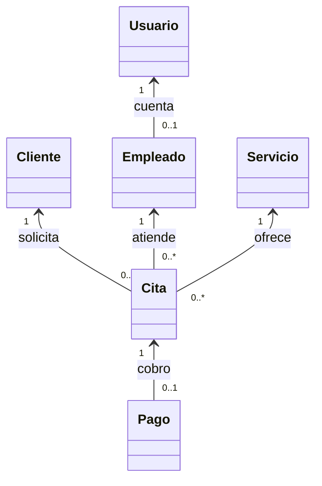

# Descripción inicial del sistema

**Nombre:** Barbería UNEV - Sistema de gestión de citas y servicios.

**Asignatura:** Programación II, UNEV. **Profesor:** Ing. Carlos Escalante.

## Problema identificado

Una barbería que organiza sus citas con una libreta o mensajes puede asignar dos clientes al mismo barbero a la misma hora, olvidar citas o perder el control de los servicios cobrados. La información de clientes, empleados y servicios queda dispersa y dificulta revisar la actividad diaria.

## Solución propuesta

Una aplicación de escritorio permite que el personal inicie sesión, consulte servicios y programe una cita asociando un cliente, un barbero y una fecha. Comprueba cruces de horarios, distingue citas pendientes, completadas y canceladas, y relaciona cada pago con la cita atendida. Esta primera versión incluye Login y Registro con almacenamiento local de cuentas y un flujo de barbería con datos de muestra en memoria.

## Usuarios

- Administrador: responsable de la operación y futura configuración de la barbería.
- Recepcionista: organiza la agenda y registra pagos.
- Barbero: atiende servicios y consulta sus citas.

Los roles se guardan en las cuentas, pero los permisos diferenciados son una mejora futura. Los clientes son entidades atendidas por el personal; no necesitan una cuenta en esta versión.

## Funciones principales

1. Autenticar al personal mediante usuario y contraseña.
2. Registrar cuentas con validación de datos y rol.
3. Consultar los clientes, barberos y servicios disponibles de la muestra.
4. Programar citas y evitar cruces de horario.
5. Completar o cancelar una cita.
6. Registrar un pago por cita completada y evitar duplicación del cobro.
7. Consultar el total cobrado durante la ejecución.

El mantenimiento completo de clientes, empleados y servicios y la persistencia de citas se incorporarán posteriormente.

## Entidades y relaciones

| Clase | Atributos principales | Métodos y propósito |
|---|---|---|
| Usuario | id, nombre, apellido, usuario, correo, rol, sal y hash | Encapsula los datos del personal y verifica la contraseña. |
| Cliente | id, nombre, teléfono | Identifica a la persona que solicita el servicio. |
| Empleado | id, usuario, especialidad | Une la cuenta del personal con el barbero asignado. |
| Servicio | id, nombre, precio, duración | Define el servicio ofrecido y valida valores positivos. |
| Cita | cliente, empleado, servicio, fecha, precio y duración acordados, estado | Relaciona entidades; permite completar o cancelar una cita pendiente. |
| Pago | id, cita, monto, fecha | Representa el cobro exacto de una cita completada. |

## Ejemplo integrado

Un recepcionista ingresa al sistema, selecciona al Cliente de ejemplo, asigna al barbero Carlos Demo y el servicio Corte clásico (RD$350, 30 minutos). Agenda una fecha futura a las 09:00. El sistema rechaza otra cita para ese barbero a las 09:15, pero permite una a las 09:30. Al completar el servicio, registra el pago de RD$350. Una cita cancelada no se puede completar ni cobrar.

## Aplicación de POO y evolución

Los atributos son privados y los métodos controlan su modificación. Los constructores garantizan datos básicos válidos. Las entidades se conectan mediante referencias a objetos, no mediante archivos aislados. Las reglas de negocio están fuera de los controladores JavaFX; se podrán reutilizar cuando se incorporen MariaDB, servicios web y una aplicación móvil.

## Uso de inteligencia artificial

Codex asistió en la lectura de requisitos, diseño de clases, implementación de formularios, pruebas y documentación. El estudiante debe revisar el código y ser capaz de explicar los constructores, encapsulamiento, relaciones, validaciones y flujo de eventos FXML. La autorización del asistente corresponde al docente.
